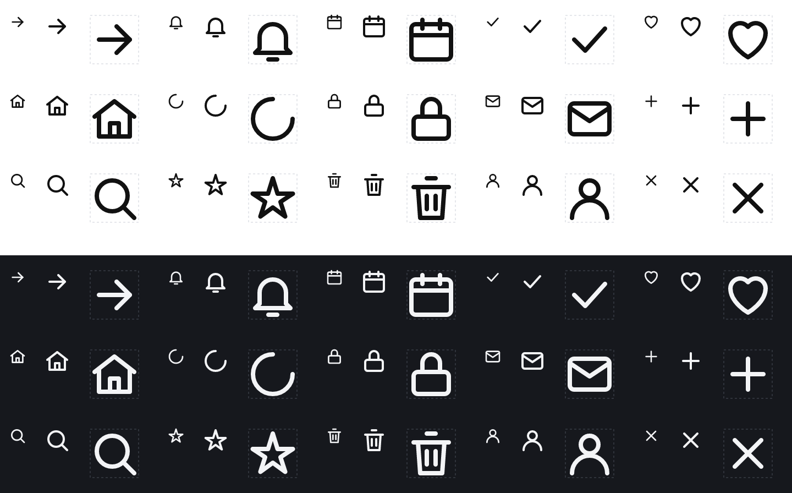

# Zoro Icons

[](https://www.npmjs.com/package/@selzerey/zoro-icons)
[](https://github.com/selzerey/zoro-icons/actions/workflows/ci.yml)
[](LICENSE)


**Consistent, verified SVG icons — from the first sketch to the favicon.** Zoro Icons checks any icon set the way
a careful icon designer would (grid, padding, stroke weight, pixel alignment, balance, colours, safety), fixes what
can be fixed without changing a pixel, shows you the result, and ships it as React, Vue, web components, a sprite,
favicons and app icons.

It works as an **agent skill for Claude Code and Codex** — ask *"draw a settings icon that matches ./icons"* and the
agent draws it, checks it, renders it, looks at it and fixes it — and as a plain **command line tool**.



*The example set in [`examples/basic`](examples/basic), rendered by `zoro-icons render`: every icon at 16, 24 and
48 px on light and dark, with the padding (live area) dashed.*

```text
$ npx @selzerey/zoro-icons lint ./icons

# Icon lint: ./icons

17 icons · grid 24×24, padding 1, stroke 2 round/round, mono · Error 1 · Warning 2 · Info 1

## Error
### Artwork extends past the viewBox and is clipped `out-of-bounds` (1)
- cloud-upload — 1 unit outside

## Warning
### Fixed colours in a single-colour set: the icon will not follow the text colour or dark mode; use currentColor `hardcoded-color` (1)
- logo-mark — #0f172a
### Stroke width, line cap or line join differs from the set: lines look thicker/thinner or corners differ `stroke-mismatch` (1)
- bell — stroke-width 1.5 (set 2)

## Info
### Artwork box is noticeably off the centre of the canvas: fine for deliberately asymmetric shapes, otherwise centre it `off-center` (1)
- cloud-upload — centre off by -0.375, 2.125 units
```

## Contents

- [Why](#why)
- [Install](#install)
- [Commands](#commands)
- [Lint rules](#lint-rules)
- [Build: React, Vue, web component, sprite](#build-react-vue-web-component-sprite)
- [Favicons and app icons](#favicons-and-app-icons)
- [Use in CI](#use-in-ci)
- [How it measures](#how-it-measures)
- [Contributing](#contributing)

## Why

AI agents and design tools produce SVG icons quickly, but nobody checks them: strokes drift from 2 to 1.5, artwork
touches the edge, a fixed `#000` breaks dark mode, a line sits half a pixel off and turns blurry, an exported file
carries a `<script>`. Existing tools either optimize (SVGO) or generate, but none tells you whether 40 icons look
like one family.

- **Measured, not guessed.** Geometry comes from rendered pixels — strokes, round caps and joins included — so
  padding and clipping are exact.
- **Low noise.** Tested on the 2,167 icons of Lucide: 0 errors, 1 real warning. Judgement calls are `info`, and
  [`references/false-positives.md`](references/false-positives.md) explains each one.
- **Safe fixes.** `fix` renders every icon before and after optimizing and refuses any change that moves pixels.
- **Look before you claim.** Contact sheets on light and dark at real sizes, as PNG — which AI agents can read.
- **Everything to ship.** Accessible components, a sprite, favicons that pass Google's rules, maskable PWA icons,
  iOS (Icon Composer layers) and Android adaptive icons.
- **Zero install.** No `npm install`: SVGO and the resvg renderer (WebAssembly) are bundled. Works offline.

## Install

Requires **Node.js 20+**.

| Where | How |
|---|---|
| Claude Code | `/plugin install zoro-icons --marketplace selzerey/zoro-icons` |
| Claude Code (older than 2.1.275) | `/plugin marketplace add selzerey/zoro-icons` then `/plugin install zoro-icons@zoro-icons` |
| Codex | `npx @selzerey/zoro-icons install --codex` (copies to `~/.agents/skills`), then restart Codex |
| Both | `npx @selzerey/zoro-icons install` (every agent found) · `--project` for this repository only |
| Other agents (Cursor, Gemini CLI, …) | `npx skills add selzerey/zoro-icons` |
| Terminal only | `npx @selzerey/zoro-icons help` or `npm install -g @selzerey/zoro-icons` |

Then ask your agent, for example:

- *"Check ./src/icons for consistency and fix what is safe."*
- *"Draw `cloud-upload` and `cloud-download` icons that match the set in ./icons."*
- *"Make a favicon and PWA icons from logo.svg, dark-mode friendly."*
- *"Turn ./icons into React components with TypeScript types."*

## Commands

After `npm install -g @selzerey/zoro-icons` the command is `zoro-icons`; without installing, prefix each line with
`npx @selzerey/zoro-icons` instead.

```bash
zoro-icons init ./icons                  # save the set's grid rules to zoro-icons.json (or 24-grid defaults)
zoro-icons new ./icons cloud-upload      # new icon with the right root attributes
zoro-icons lint ./icons                  # report; exit code 1 on errors (--format json, --only, --skip)
zoro-icons fix ./icons --write           # SVGO + editor junk + currentColor, pixel-checked
zoro-icons render ./icons                # icons/icon-sheet.png + icon-sheet.md legend
zoro-icons render logo.svg --size 512    # one PNG
zoro-icons build ./icons --out dist      # React, Vue, <zoro-icon>, sprite, icons.json, preview.html
zoro-icons favicon logo.svg --out public --dark-color "#f5f5f5"
zoro-icons app logo.svg --background "#2563eb" --color "#ffffff"
zoro-icons doctor                        # where the skill is installed
```

`zoro-icons.json` (written by `init`, edit freely):

```json
{ "size": 24, "padding": 1, "stroke": 2, "linecap": "round", "linejoin": "round", "style": "stroke", "color": "mono" }
```

`style` is `stroke`, `fill` or `mixed`; `color` is `mono` (currentColor only) or `multi`.

## Lint rules

| Severity | Rule | Finds |
|---|---|---|
| error | `parse-error` | not valid SVG |
| error | `unsafe-content` | script, foreignObject, `on*` handlers, `javascript:`, external references |
| error | `embedded-raster` | `<image>` bitmaps |
| error | `viewbox-missing` / `viewbox-mismatch` | no viewBox, or a different grid than the set |
| error | `empty-icon` | nothing visible |
| error | `out-of-bounds` | artwork clipped by the viewBox |
| warn | `padding` | artwork inside the set's padding |
| warn | `hardcoded-color` | fixed colours or the implicit black fill in a single-colour set |
| warn | `stroke-mismatch` | stroke width, cap or join different from the set |
| warn | `text-element` | `<text>` (font-dependent) |
| warn | `animation-reduced-motion` | animation without a `prefers-reduced-motion` fallback, or SMIL |
| warn | `name-format` / `duplicate-icon` | non-kebab-case names, identical artwork under two names |
| info | `pixel-misaligned` | straight lines between pixels at 1× (blurry) |
| info | `near-miss-angle` | long lines 0.3–3° off 0°/45°/90° |
| info | `off-center`, `weight-outlier`, `size-outlier`, `style-mismatch` | icons that stand out from the set |
| info | `precision`, `editor-junk`, `large-file`, `animation-costly` | clean-up hints |

## Build: React, Vue, web component, sprite

```bash
zoro-icons build ./icons --out ./dist --formats react,vue,element,sprite,svg,json,preview
```

```jsx
import { ArrowRight, Check } from "./dist/react";

<ArrowRight size={20} />                    // decorative: aria-hidden="true"
<Check title="Saved" />                     // informative: role="img" + aria-label + <title>
<button aria-label="Close"><X /></button>   // label the button, keep the icon decorative
```

```html
<!-- Vue: same props. Web component: -->
<script type="module" src="dist/element/zoro-icon.js"></script>
<zoro-icon name="arrow-right" size="20" label="Next"></zoro-icon>

<!-- Sprite -->
<svg width="24" height="24" aria-hidden="true"><use href="dist/sprite.svg#icon-arrow-right"/></svg>
```

Ids inside icons are prefixed per icon, so gradients and clip paths never collide when many icons are inlined.
`preview.html` is a searchable gallery with copy buttons, a size slider and a dark-mode switch.

## Favicons and app icons

```bash
zoro-icons favicon logo.svg --out public --color "#111111" --dark-color "#f5f5f5" --name "My App"
```

| File | Purpose |
|---|---|
| `favicon.ico` | 16/32/48 PNG frames — browsers, Google Search (which does not accept SVG) |
| `favicon.svg` | modern browsers; switches colour in dark mode (Chrome, Firefox) |
| `favicon-96x96.png` | Google recommends larger than 48×48 |
| `apple-touch-icon.png` | 180×180, opaque (iOS fills transparency with black) |
| `web-app-manifest-192x192.png`, `-512x512.png` | PWA install icons (`purpose: any`) |
| `maskable-icon-512x512.png` | artwork inside the 40% safe circle (`purpose: maskable`) |
| `site.webmanifest`, `head.html` | manifest and the `<link>` tags to paste |

It also renders the icon on light and dark browser tabs at 16 and 32 px and warns when it disappears — Safari
ignores dark mode inside SVG favicons, so this catches the black-logo-on-dark-tab problem.

```bash
zoro-icons app logo.svg --background "#2563eb" --color "#ffffff" --targets ios,android
```

iOS: 1024 default (opaque), dark and tinted variants, and background/foreground layer SVGs for Xcode's Icon
Composer. Android: adaptive foreground/background/monochrome layers (432 px, artwork in the 66 dp safe zone),
`mipmap-anydpi-v26/ic_launcher.xml` and the 512 Play Store icon. Sources for every requirement:
[`references/platform-specs.md`](references/platform-specs.md).

## Use in CI

```yaml
- run: npx -y @selzerey/zoro-icons lint ./src/icons   # fails the job on errors
```

## How it measures

- SVG is parsed with SVGO's parser; presentation attributes are resolved through `<g>` inheritance and inline styles.
- Each icon is rendered with resvg on a canvas a quarter larger on every side, so artwork outside the viewBox is
  visible; the artwork box is the half-coverage pixel edge, accurate to about 1/16 unit on a 24 grid.
- Set rules compare each icon with the set's median (ink coverage, artwork size).
- `fix` compares the alpha channel of the original and optimized render and keeps the original if more than 0.2% of
  pixels change.

## Contributing

See [CONTRIBUTING.md](CONTRIBUTING.md). `npm test` checks every rule against a planted problem and a realistic trap.
Bug and false-alarm reports are very welcome.

## License

[MIT](LICENSE). Bundled SVGO (MIT) and resvg (MPL-2.0, unmodified): [THIRD_PARTY_NOTICES.md](THIRD_PARTY_NOTICES.md).
The example icons in `examples/` are original and MIT licensed.
